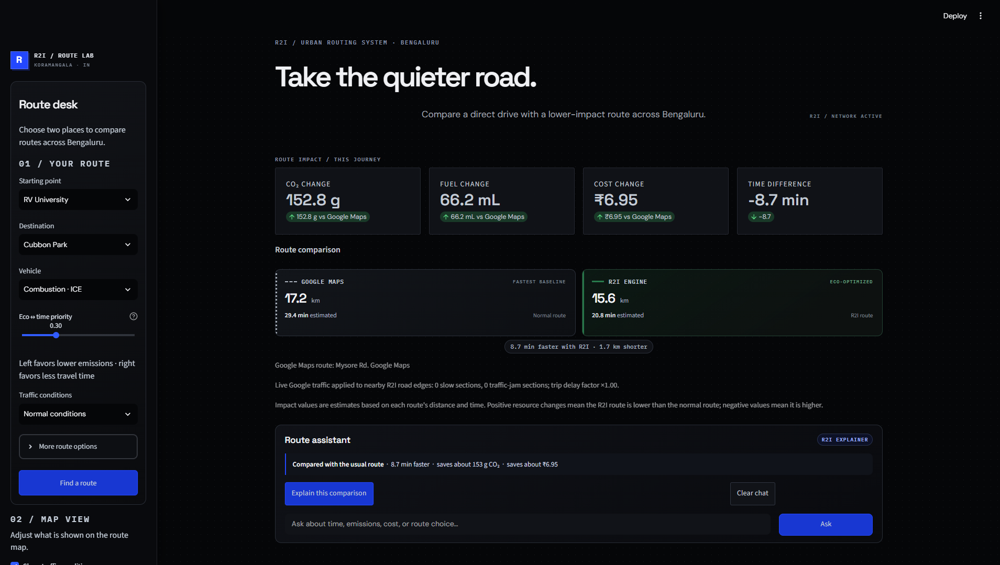
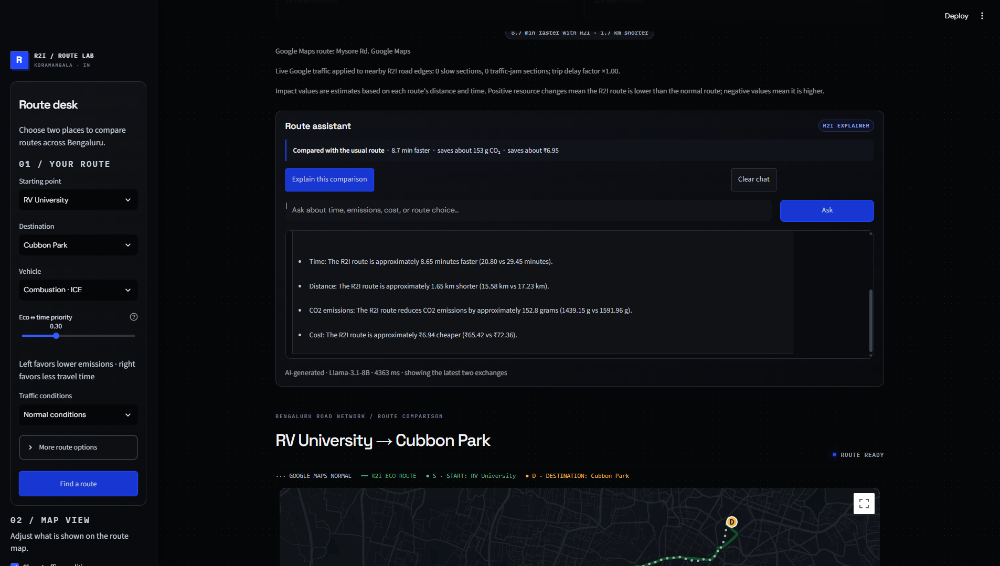
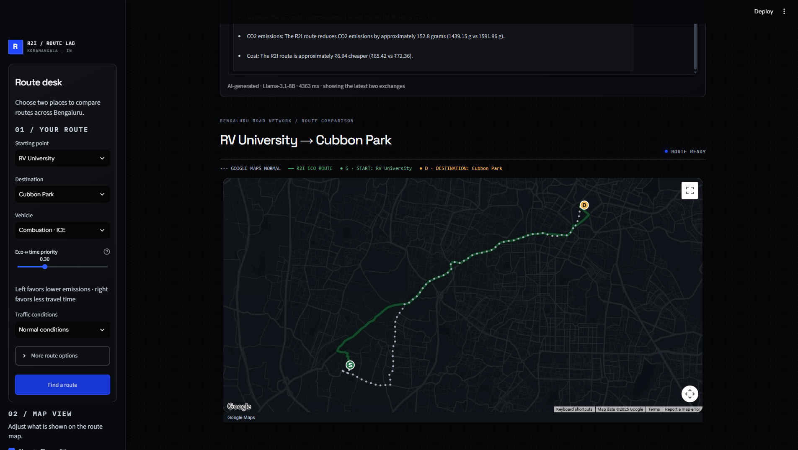

# R2I — Route to Impact

**A Bengaluru eco-routing prototype that compares a familiar route with an alternative selected for a configurable balance of travel time, emissions, congestion, and route risk.**

R2I combines a Streamlit interface with a local OpenStreetMap road graph, classical candidate-route generation, and an experimental quantum-inspired selector. An optional Qualcomm Imagine assistant explains the computed comparison; it does not choose or modify routes.

> **Project status:** Hackathon / research prototype. Emissions, fuel, cost, and risk are estimates. The quantum-inspired selector runs classical simulated annealing on a CPU; it does not use quantum hardware or claim quantum speedup.

## Screenshots

### Route comparison and assistant



### Assistant and route map



### Map detail



## What it does

- Compare a Google Maps normal route with an R2I-selected alternative when Google Maps credentials are configured.
- Use a bundled Bengaluru road network for local route optimization, with an OSRM alternatives fallback for trips outside local coverage.
- Adjust the eco-versus-time preference and select traffic scenarios and route constraints.
- Display route geometry, start and destination markers, route metrics, and estimated resource changes.
- Optionally ask Qualcomm Imagine to explain a computed result or answer follow-up questions using a limited summary of that trip.
- Run reproducible offline comparisons with the included benchmark scripts.

## How routing works

For trips covered by the local road graph, R2I:

1. Snaps the selected endpoints to nearby road-network nodes.
2. Applies available traffic adjustments and removes roads marked closed.
3. Finds a fastest-time route and generates up to ten travel-time-ordered candidate paths.
4. Filters candidates using detour, risk, and optional time limits.
5. Normalizes candidate travel time, estimated carbon, congestion exposure, risk, and detour, then scores them using weights controlled in part by the eco/time preference.
6. Encodes candidate selection as an exactly-one QUBO and runs bounded simulated annealing. An exact classical argmin check safeguards the selection.

The R2I route may be shorter, longer, faster, or slower than the baseline depending on the available candidates, data, constraints, and selected preference. Distance is not a direct term in the local QUBO objective, although it affects edge-derived resource estimates.

For trips outside bundled graph coverage, the app uses available OSRM alternatives and a simpler time/emissions score. This fallback does not use the local candidate QUBO pipeline. See [the implementation plan](QUANTUM_INSPIRED_IMPLEMENTATION_PLAN.md) for details and limitations.

## Architecture

```text
Streamlit UI
    ├── route inputs, comparison, map, and metrics
    ├── optional Qualcomm Imagine explanation layer
    └── traffic scenario controls

Local routing
    ├── r2i_engine.py       graph loading and route metric calculations
    ├── candidate_routes.py candidate paths, feasibility, and objective scores
    ├── quantum_inspired.py one-hot QUBO and classical simulated annealing
    └── traffic_provider.py offline/live traffic scenario interface
```

The Imagine assistant receives only allowlisted trip labels, computed route metrics, and relevant optimizer/traffic metadata. It is called only after the user asks for an explanation or submits a question. Generated text is separate from engine output.

## Run locally

Requires Python 3.13 (or another version supported by the pinned dependencies).

```bash
python -m venv .venv
# Windows PowerShell
.venv\Scripts\Activate.ps1
# macOS / Linux: source .venv/bin/activate

python -m pip install -r requirements.txt
python -m streamlit run app.py
```

The app loads `bengaluru_grid.graphml` from the repository directory. The included graph supports the bundled local coverage. `fetch_map.py` can download replacement map data, but fetching is not required for startup.

## API keys and secrets

The app can run local routing without API keys. Google Maps comparison and the Qualcomm Imagine assistant are optional.

For local development:

1. Copy `.streamlit/secrets.toml.example` to `.streamlit/secrets.toml`.
2. Add your restricted Google Maps and/or Imagine credentials to the local file.
3. Keep `.streamlit/secrets.toml` private. It is ignored by Git.

For Streamlit Community Cloud, add secrets in the app's **Settings → Secrets** area. Do not upload or commit your local secrets file. The Google Maps browser key is delivered to the browser, so restrict it by HTTP referrer and enabled APIs; keep the Imagine key server-side. If a key has been exposed, revoke or rotate it before deploying.

## Deploy on Streamlit Community Cloud

1. Push this repository to GitHub.
2. At [share.streamlit.io](https://share.streamlit.io/), create an app from the repository's `main` branch.
3. Set `app.py` as the app entrypoint and select Python 3.13.
4. Add only the required secrets in **Settings → Secrets**. Google Maps is optional; Imagine is optional.
5. Deploy, then verify a local-coverage route, an outside-coverage route, the map, and the assistant if enabled.

Dependencies are pinned in [`requirements.txt`](requirements.txt). Streamlit configuration is in [`.streamlit/config.toml`](.streamlit/config.toml). This repository is designed to run as a Streamlit server; Netlify static hosting is not configured for it.

## Benchmarks

Run the offline, seeded algorithm comparison without API credentials:

```bash
python benchmark.py --graph bengaluru_grid.graphml --output output/benchmark --pairs 30 --seed 42
```

The benchmark writes CSV and JSON results under `output/benchmark/`. A separate Google comparison script exists in `benchmark_comparison.py` and requires a Google Maps server key. Treat all estimates and comparisons in context: external providers may use different graph data, traffic models, and route-generation methods.

## Limitations

- Coverage and route quality depend on the bundled road graph and endpoint snapping.
- Traffic may be scenario-based or incomplete; live Google data is optional.
- Fuel, energy, emissions, cost, and reliability are modeled estimates, not measured vehicle telemetry.
- Google and local R2I routes may use different road networks and traffic sources, so the comparison is informative rather than a controlled same-graph experiment.
- The one-hot candidate-selection QUBO has an exact classical argmin equivalent. This prototype demonstrates a QUBO workflow; it does not establish a quantum advantage.
- The AI assistant may produce imperfect wording. The route and metric values displayed by R2I remain the computed source of truth.

## Project documents

- [Project overview](PROJECT_ONE_PAGER.md)
- [Logic specification](PROJECT_LOGIC_SPEC.md)
- [Quantum-inspired implementation plan](QUANTUM_INSPIRED_IMPLEMENTATION_PLAN.md)
- [Qualcomm AI assistant implementation plan](QUALCOMM_AI_ASSISTANT_IMPLEMENTATION_PLAN.md)

## License

No license has been added yet. Add a license before inviting reuse or contributions.
