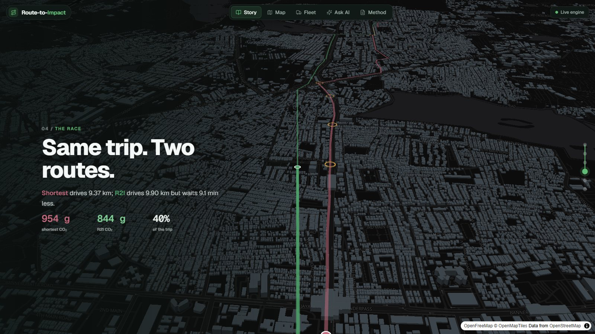
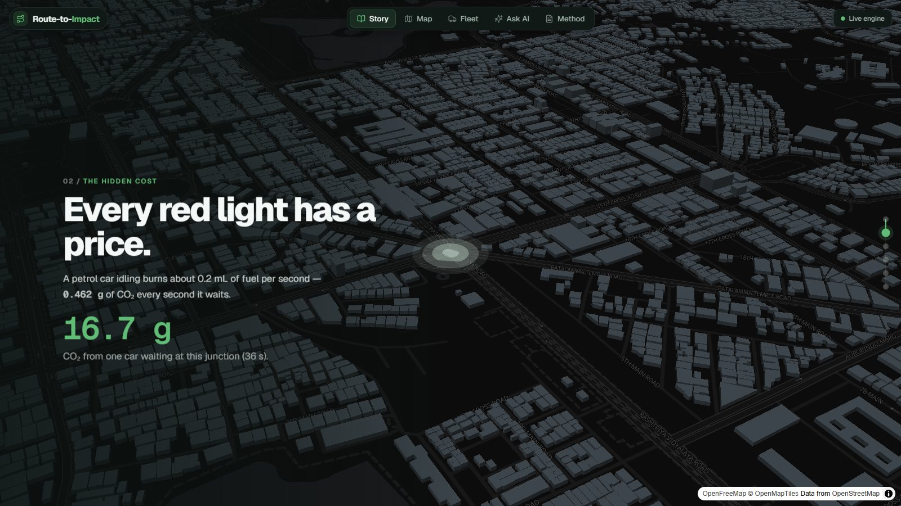
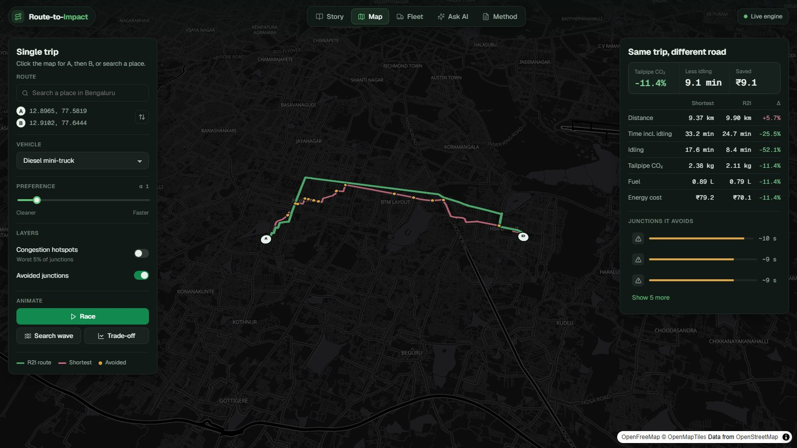
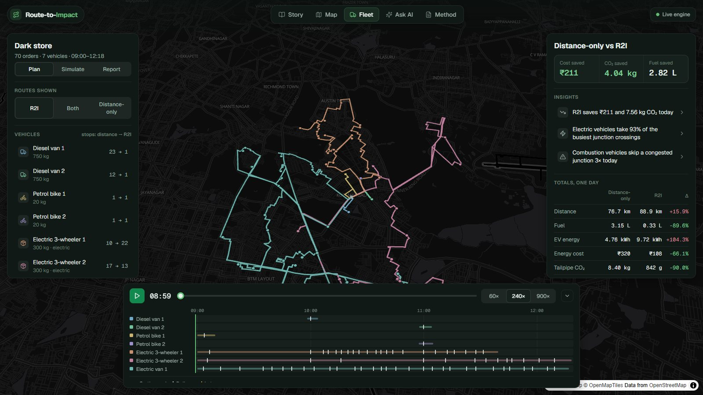
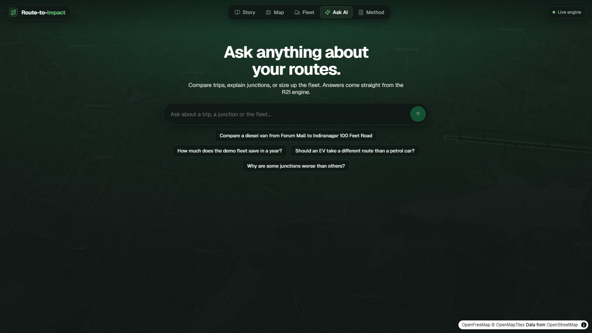
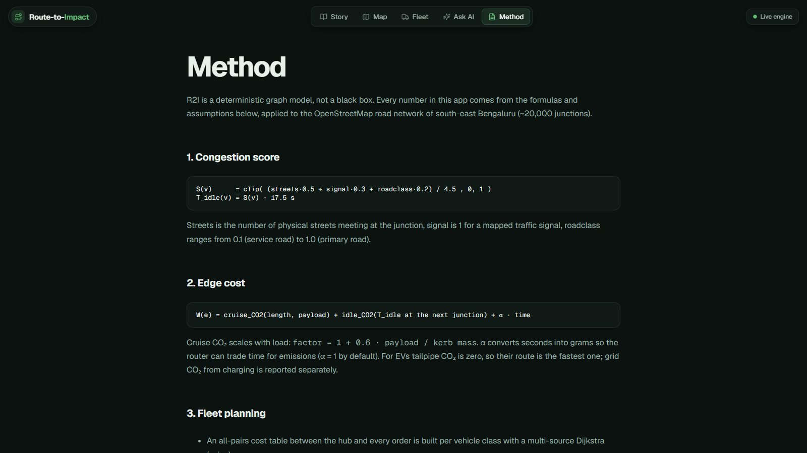

# Route-to-Impact (R2I)

**Congestion-aware eco-routing and delivery-fleet planning for Bengaluru.**
The shortest route is not the cleanest one: vehicles burn fuel while idling at busy,
signal-heavy junctions. R2I predicts that idling from OpenStreetMap road structure, routes
around it, and plans mixed petrol / diesel / electric delivery fleets on real emissions and
cost instead of kilometres.



> All CO₂, fuel and ₹ figures are **modelled estimates** from published vehicle data, not
> measurements. See [Method](#how-it-works) and [docs/assumptions.md](docs/assumptions.md).

---

## What you can do

| | |
|---|---|
| **Story** — a scroll-driven 3D explainer: the hidden cost of idling, the worst junctions, a live race between two routes, and the jump to a whole fleet. |  |
| **Map** — pick any two points (or search a place), choose a vehicle, and compare the shortest route with the R2I route: distance, time, idling, CO₂, fuel and cost, plus the junctions it avoids. Animate the race, the Dijkstra search wave, and the speed-vs-emissions trade-off. |  |
| **Fleet** — a dispatcher console for one dark store: 70 orders, 7 mixed vehicles. Distance-only planning vs R2I planning with the same solver and constraints, a day-long simulation with live payloads, a schedule, and plain-language insights. |  |
| **Ask AI** — ask in plain English ("compare a diesel van from Forum Mall to HSR Layout"). An LLM calls the routing engine as tools and draws the answer on the map. |  |
| **Method** — formulas, assumptions and limitations. |  |

**Demo result (fleet preset):** fuel 3.15 L → 0.33 L and energy cost ₹320 → ₹108 per morning,
100% on time in both plans — mostly by giving the electric vehicles the congested work.

---

## How it works

```
S(v)      = clip((streets·0.5 + signal·0.3 + roadclass·0.2) / 4.5, 0, 1)   junction congestion score
T_idle(v) = S(v) · 17.5 s                                               predicted wait
W(e)      = cruise_CO₂(length, payload) + idle_CO₂(T_idle) + α · time       edge cost
```

1. **Road network** — OpenStreetMap via **OSMnx** (≈20,000 junctions, south-east Bengaluru),
   cleaned and scored per junction.
2. **Routing** — Dijkstra on `W(e)` vs. shortest distance; α trades seconds for grams.
3. **Vehicles** — petrol/EV cars, petrol 2-wheeler, EV 3-wheeler, diesel and EV mini-trucks;
   cruise energy scales with payload; EVs report grid CO₂ separately.
4. **Fleet** — many-to-many costs with scipy, **Google OR-Tools** VRP with capacity, delivery
   windows and EV range; stops re-ordered for the actual load.
5. **Ask AI** — OpenAI-compatible LLM (Qualcomm AI Playground, Llama 3.3 70B) or Claude, with four
   tools: `find_place`, `compare_route`, `fleet_summary`, `vehicle_classes`.

```
web/  React + MapLibre + deck.gl ──HTTP──▶  api/  FastAPI ──▶  src/r2i/  engine (NetworkX, OR-Tools)
      static demo data fallback                      └──▶  LLM provider · geocoder
```

---

## Run locally

Requirements: Python 3.10+, Node 20+.

```bash
python -m venv .venv && .venv\Scripts\activate        # Windows  (source .venv/bin/activate on macOS/Linux)
pip install -e ".[api,dev]"
cp .env.example .env                                   # optional: add your AI / geocoding keys
uvicorn api.main:app --port 8000                       # API
npm --prefix web install && npm --prefix web run dev   # web app on http://localhost:5173
```

- `pytest -q` runs the engine, fleet and API tests.
- `npm --prefix web run preview:prod` serves the production build on :4173 (judge speed here).
- Without the API the web app still works from precomputed demo data.

### Configuration (`.env`, never committed)

| Variable | Used for |
|---|---|
| `INFERENCE_CLOUD_API_KEY`, `INFERENCE_CLOUD_ENDPOINT` | Ask AI via Qualcomm AI Playground (OpenAI-compatible) |
| `ANTHROPIC_API_KEY` | Ask AI via Claude, when no Inference Cloud key is set |
| `GOOGLE_MAPS_API_KEY` | Place search via Google Geocoding (falls back to OpenStreetMap) |
| `R2I_CORS` | Web origins allowed to call the API |

---

## Deploy

| Part | Where | How |
|---|---|---|
| API | Render, Fly.io, Railway, any Docker host | `docker build -t r2i-api . && docker run -p 8000:8000 --env-file .env r2i-api` (Render: `render.yaml`) |
| Web | Vercel, Netlify, any static host | root `web/`, build `npm run build`, output `dist/`, set `VITE_API_URL` (see `web/vercel.json`) |

Set `R2I_CORS` on the API to the web app's URL.

---

## Project layout

```
api/            FastAPI service (routes, fleet planning, Ask AI, geocoding)
src/r2i/        engine: graph pipeline, congestion model, vehicles, router, fleet planner
web/            React app (Story, Map, Fleet, Ask AI, Method)
scripts/        precompute demo data for the web app
data/raw/       prepared OSM road graph
tests/          pytest suites
docs/           methodology, assumptions, plans, screenshots
```

## Limitations

- Congestion is a static structural proxy — no live or time-of-day traffic.
- Travel times are free-flow OSM speeds plus predicted junction idling.
- Fleet plans come from a time-limited heuristic solver; optimality is not guaranteed.

## License

MIT
